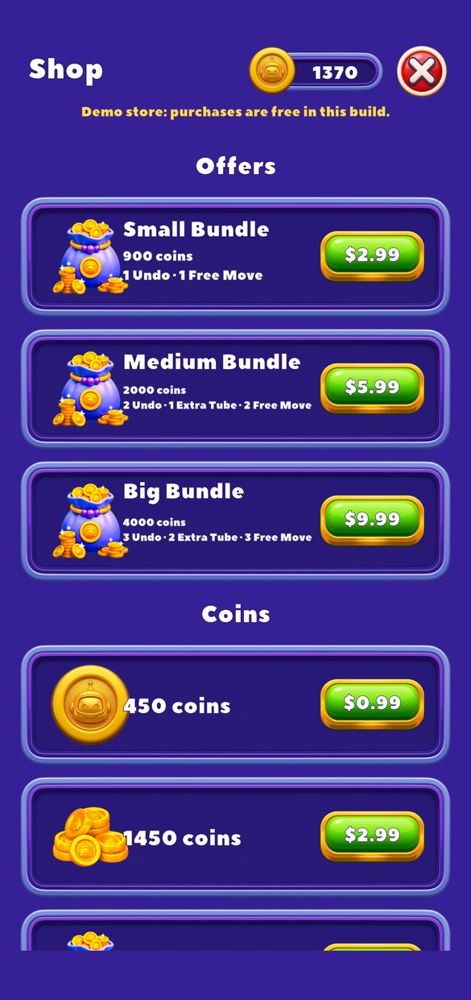
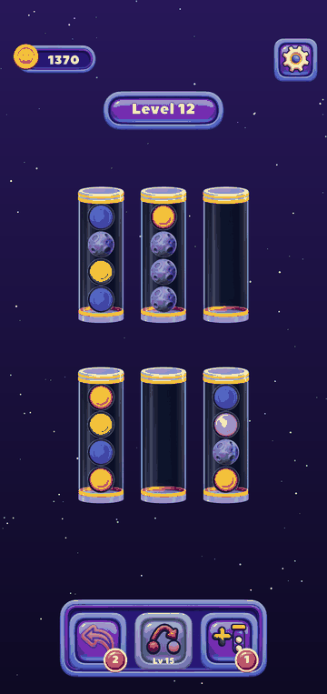
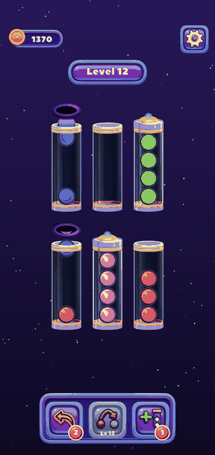
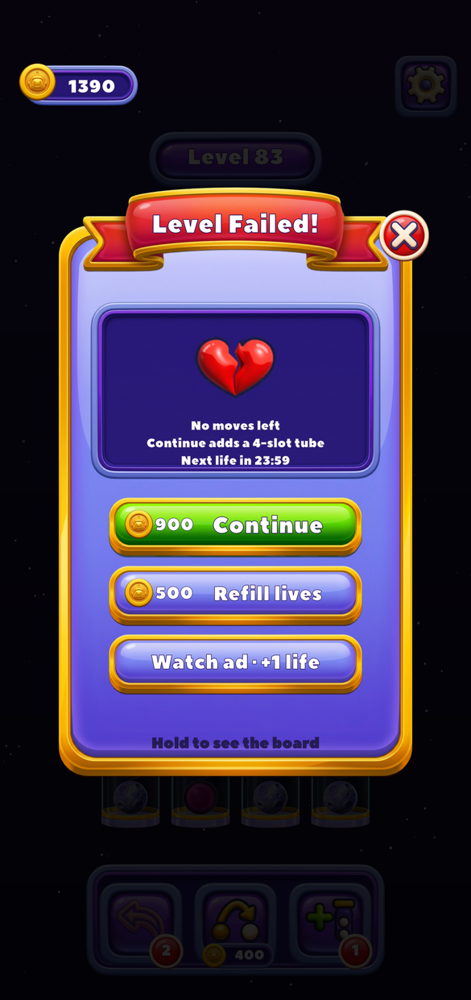
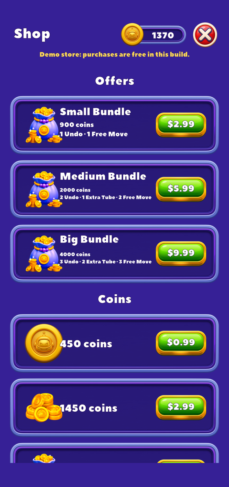
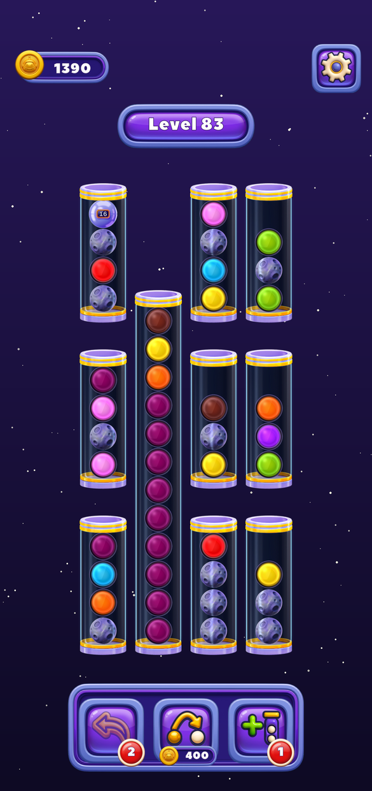

<h1>Orbit Sort</h1>

A space-themed ball sort puzzle for portrait mobile. Tap a tube to lift its top group of orbs, tap another to warp them through the portals. Fill every tube with a single color to win.

<h2>Gameplay</h2>

<table>
  <tr>
    <td align="center"><b>Home</b><br/>Level orb, daily reward, events</td>
    <td align="center"><b>Play</b><br/>Warp moves, boosters</td>
    <td align="center"><b>Win</b><br/>Orbit sweep, mascot, coins</td>
  </tr>
  <tr>
    <td></td>
    <td></td>
    <td></td>
  </tr>
  <tr>
    <td align="center"><b>Fail</b><br/>Continue, refill lives, hold to see the board</td>
    <td align="center"><b>Shop</b><br/>Bundles, coin packs, No Ads (demo)</td>
    <td align="center"><b>Obstacles</b><br/>Hidden orbs, bomb fuse, tower tube</td>
  </tr>
  <tr>
    <td></td>
    <td></td>
    <td></td>
  </tr>
</table>

<h2>Features</h2>

- **Campaign:** 100 levels with 5 layout variants each; a retry plays the next variant. Every board is checked solvable.
- **Opening chain:** levels 1 to 10 run back to back with a side swipe, no menu in between.
- **Tubes:** 4, 8, 12 and 16 slots, up to 6 per row.
- **Obstacles:** hidden orbs, frozen tubes, shutters opened by key orbs, bombs with a move fuse.
- **Boosters:** Undo, Extra Tube and Free Move, each introduced with a one-time card and a hand tutorial.
- **Fail flow:** a rescue search decides whether Undo or Continue can still save the board.
- **Economy:** coins, 5 lives with a 30-minute refill, a 500-coin refill and a rewarded +1 life.
- **Live ops:** daily reward streak and the Orbit Rush race event.
- **Store:** beginner pack, three bundles, coin packs and No Ads. Purchases and ads are local stand-ins in this build.
- **Transitions:** a level grows out of the mascot's orb on Home; on a win the camera dives into the orb and Home opens like a vignette.
- **Languages:** English and Turkish.

<h2>Level Editor</h2>

`Tools > Project > Level Editor`

- Lists every level with its variants and previews the board.
- Add, remove and auto-arrange tubes; set each tube's size (4, 8, 12 or 16 slots).
- Paint orbs with a brush: color, hidden, key for a lockbox, bomb fuse. Freeze a tube until a color fills.
- **Solvability check:** a depth-first solver with a seen-set proves the board can be won and reports when it cannot.
- **Check All Levels** runs the solver over the whole catalog; **Import JSON...** brings in a level pack.

<h2>Architecture</h2>

```
Assets/Scripts
├── Core       engine-level systems: services, events, state machine, pooling, save, audio, haptics, localization
├── Common     shared UI (popups, safe area, hold-to-peek) and tween presets
└── Contexts   game code: Application (boot, economy), Main (Home/Game flow), Home, Game, LiveOps, Store
```

- Dependencies go one way: `Contexts → Common → Core`, each its own assembly.
- **Services:** an explicit registry filled once by the `Bootstrapper`; no hidden singletons.
- **Events:** a static typed `EventBus<T>` for economy, lives and level results.
- **Flow:** `MainFlow` runs Home and Game as states of one scene; `GameController` is a state machine (Playing, Won, Lost) split into partial files per concern.
- **Rules first:** `SortBoard`, `CampaignRules`, `LivesService` and `MonetizationService` hold no Unity state, so they are covered by EditMode tests.
- **Popups:** `PopupService` instantiates each popup once and queues the rest.
- **Pooling:** balls, tubes and effects come from `PoolService`, warmed from the item registry.

<h2>Tests</h2>

684 EditMode tests: board rules, solver, every campaign board against its recorded solution, economy, lives, store, ads frequency, live ops, tutorial, save migration.

`Window > General > Test Runner > EditMode > Run All`

<h2>Tech Stack</h2>

- **Engine:** Unity 6000.2.6f1, Built-in Render Pipeline (2D)
- **Animation:** Spine 4.3 (win stage), PrimeTween
- **Shaders:** custom orb, tube glass, ice, shell and level transition shaders
- **UI:** uGUI + TextMesh Pro, sprite atlases with ASTC 4x4
- **Input:** Input System
- **Data:** Newtonsoft JSON
- **Tests:** Unity Test Framework (NUnit)

<h2>AI Tooling</h2>

Built with **Claude Code**, using:

- **graphify** (Claude Code skill): turns the project into a knowledge graph. Its output is in `graphify-out/` (interactive `graph.html`, `graph.json` and `GRAPH_REPORT.md`).
- **caveman** (CLI with Claude Code hooks and an MCP server): compresses context and tool output to save tokens on long sessions.
- **Unity MCP** (`com.coplaydev.unity-mcp`): lets the agent drive the editor, run tests and capture screenshots.

<h2>Getting Started</h2>

1. Open the folder with **Unity 6000.2.6f1** from Unity Hub. Git must be installed; Spine and Unity MCP are pulled as Git packages.
2. Open `Assets/Scenes/Boot.unity` and press **Play**. The game always starts from Boot.
3. Editor tools are under **Tools > Project** (Level Editor, Check Levels Solvable, Build Game UI, Create Board Prefabs, ...).
4. Debug panel in Play: **F1** or a three-finger tap.
